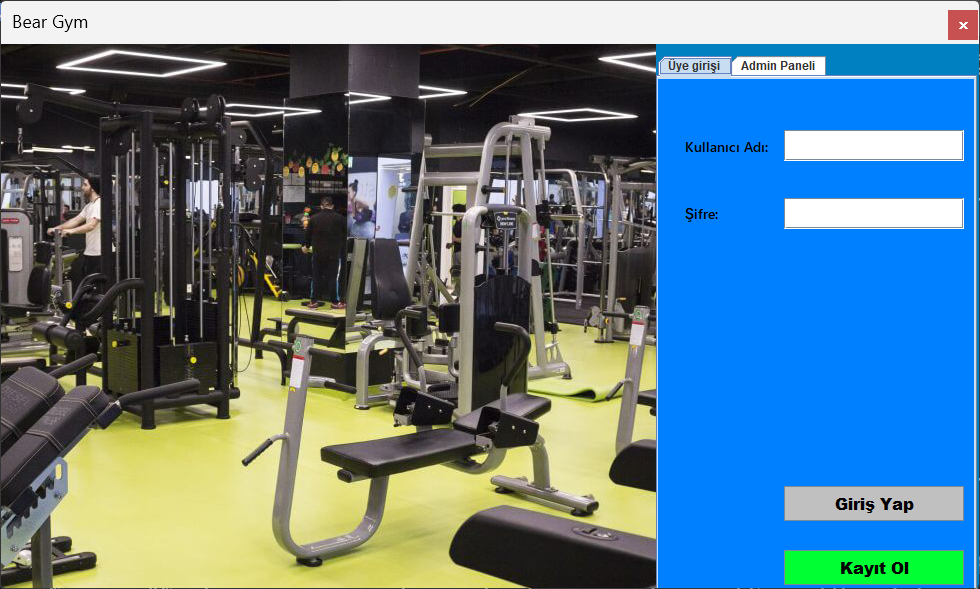
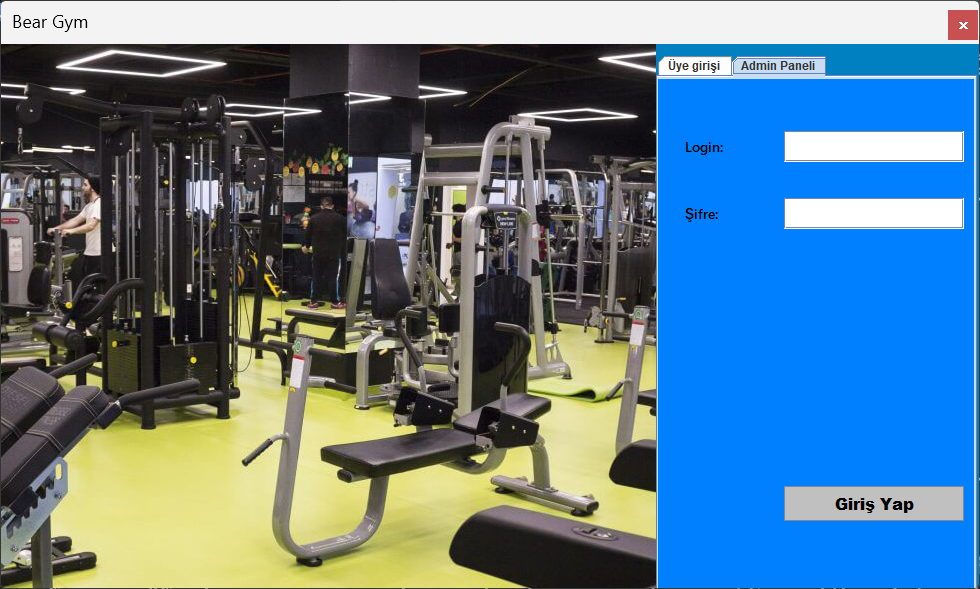
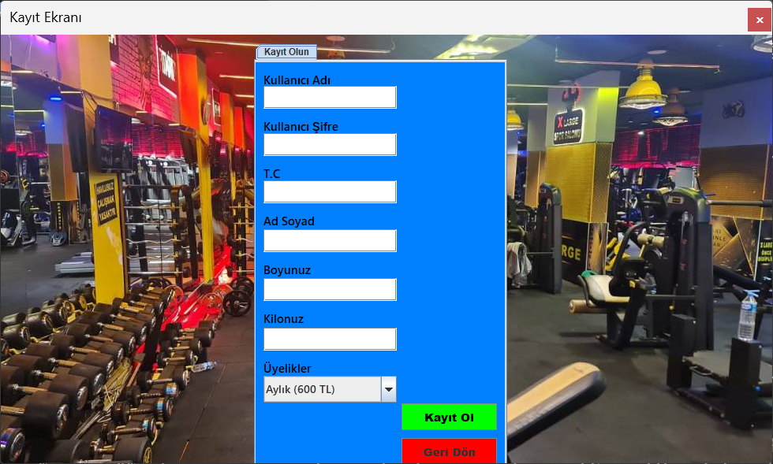
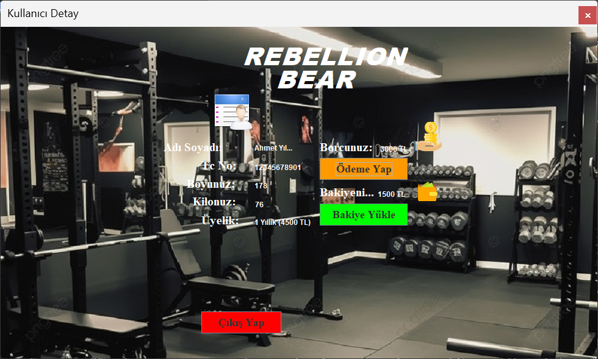
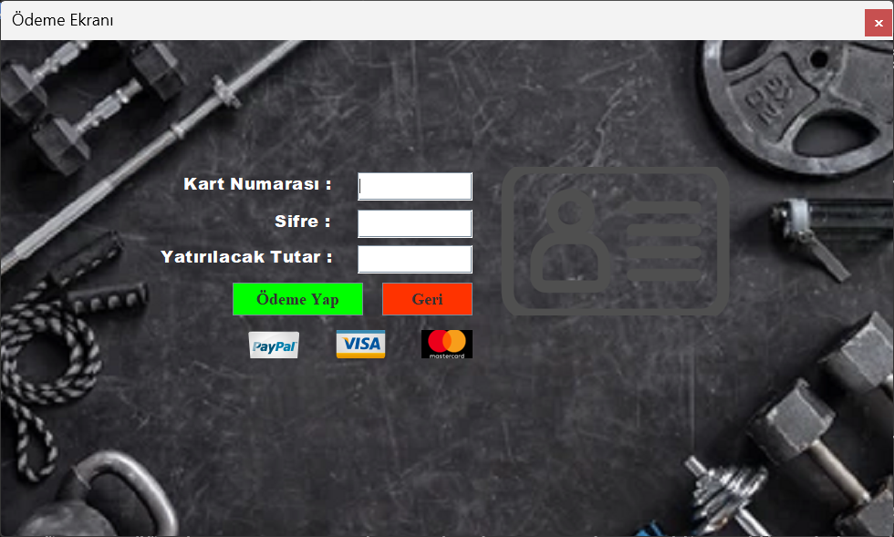
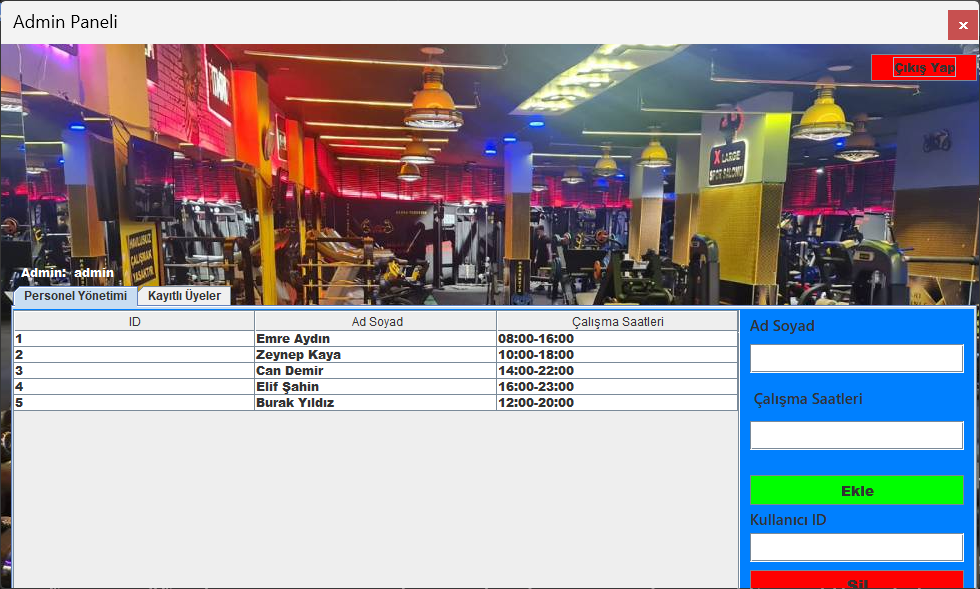
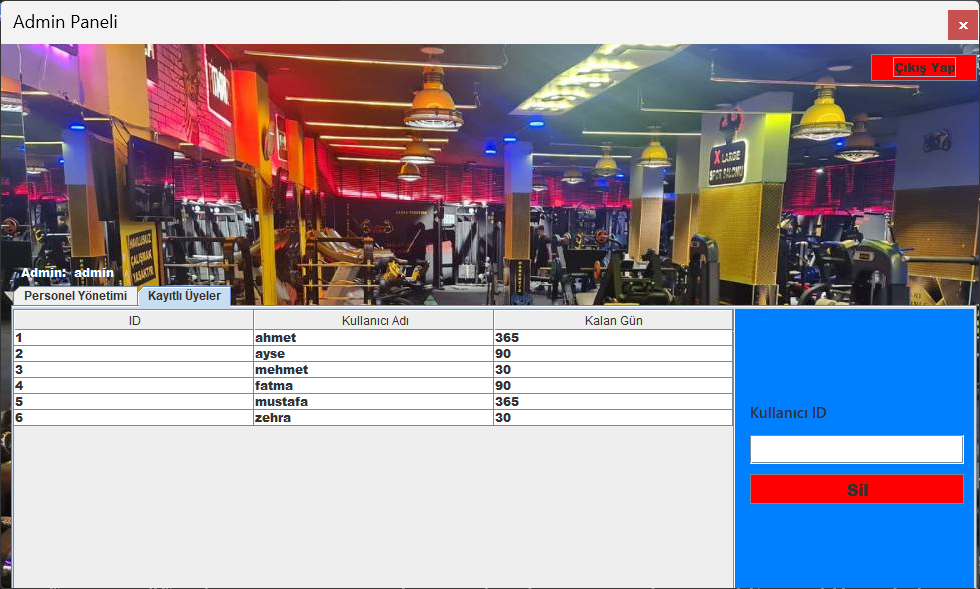

#  Spor Salonu Yönetimi İçin Masaüstü Uygulaması

Bu proje, spor salonlarının üye ve personel işlemlerini tek bir yerden yönetmesini sağlayan bir masaüstü uygulamasıdır. Üyeler sisteme kayıt olup giriş yapabilir, üyelik bilgilerini, borç ve bakiye durumlarını görüntüleyebilir, bakiye yükleyip borçlarını ödeyebilir. Yönetici (admin) ise antrenörleri ekleyip düzenleyebilir, kayıtlı üyeleri ve kalan üyelik günlerini takip edebilir. Proje, elle tutulan üyelik ve ödeme kayıtlarını dijital ortama taşıyarak takibi kolaylaştırmayı amaçlamaktadır.

---

##  Kullanılan Teknolojiler

- **Editör:** Eclipse IDE  
- **Programlama Dili:** Java  
- **Veritabanı:** MySQL  

---

##  Kullanılan Kütüphaneler

- **Java Swing** → Grafik kullanıcı arayüzü (GUI) geliştirme  
- **JDBC (mysql-connector-j 8.1.0)** → MySQL veritabanı bağlantısı ve sorguları  

---

##  Özellikler

- 🔐 Üye ve admin için ayrı giriş ekranları  
- 📝 Üye kaydı ve üyelik paketi seçimi (Aylık, 3 Aylık, 1 Yıllık)  
- 👤 Üye panelinde kişisel bilgiler, borç ve bakiye görüntüleme  
- 💳 Kart ile bakiye yükleme ve borç ödeme  
- 🏋️ Antrenör ekleme, silme ve çalışma saatlerini düzenleme  
- 📋 Kayıtlı üyeleri ve kalan üyelik günlerini listeleme  

---

##  Görseller

> Ekran görüntülerindeki tüm isimler ve bilgiler örnek (demo) verilerdir.

---
